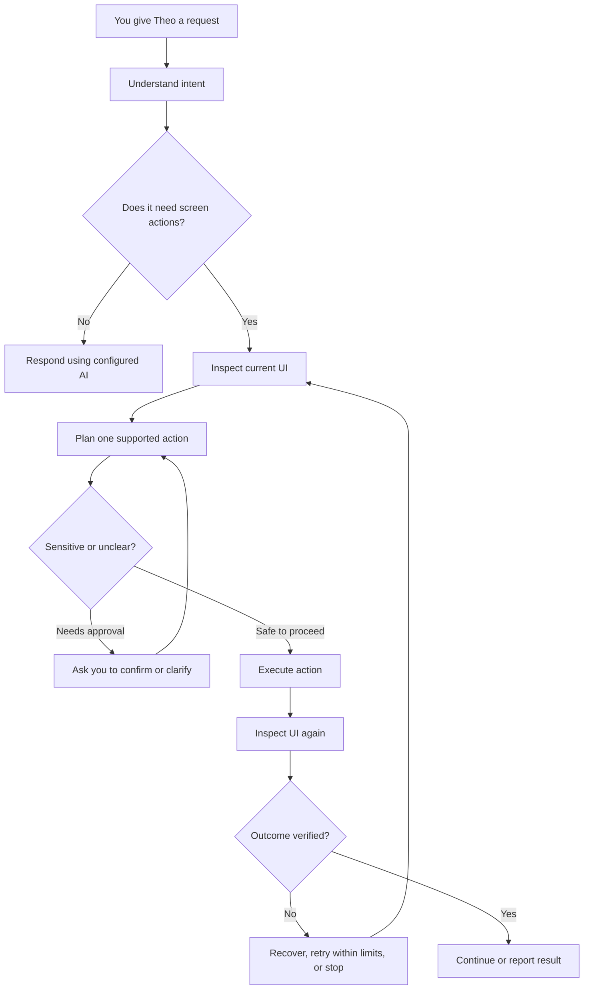

<!--
  Theo — Personal AI for Android
  Keep this README honest: distinguish shipped/documented behavior from planned work.
-->

<div align="center">

# Theo

### Your phone. Your assistant. Your rules.

**A personal Android AI assistant built to understand your screen, work with your apps, and help turn instructions into actions.**

[](https://developer.android.com/)
[](https://kotlinlang.org/)
[](https://developer.android.com/compose)
[](https://developer.android.com/)
[](https://github.com/Kentaakakashi/Theo-AI-mobile/tree/main)

[**Explore the code**](https://github.com/Kentaakakashi/Theo-AI-mobile/tree/main) · [Screen automation](SCREEN_AUTOMATION.md) · [Liquid Glass design](LIQUID_GLASS_DESIGN.md) · [Third-party notices](THIRD_PARTY_NOTICES.md)

</div>

---

> [!NOTE]
> **Main branch:** This README describes documented capabilities and the direction of the project. Items marked **Planned** are goals, not promises that the feature is already implemented. Check the source and test the current build to confirm availability.

## The idea

Most assistants stop at answering. **Theo is being built to help you get things done on your phone.**

Ask Theo to inspect the screen, open an app, find a control, or work through a multi-step task. Theo's screen-aware automation uses Android accessibility information, a configured AI planner, and step-by-step verification to make actions more grounded in what is actually on screen.

The long-term direction is a personal, local-first assistant: useful memory, reusable skills, reliable task execution, and integrations that you can inspect and control.

## What Theo is working toward

| Capability | What it means |
|---|---|
| 👀 **Screen awareness** | Inspect accessible screen content and use screenshot analysis when supported and needed. |
| 🧭 **Action planning** | Turn a request into small, structured actions instead of blindly replaying a long sequence. |
| 📱 **Android automation** | Launch apps and interact with exposed controls through Android's Accessibility Service APIs. |
| ✅ **Verification** | Re-check the UI after actions and avoid claiming success without evidence. |
| 🧠 **Personal memory** | Existing memory/history functionality, with a richer editable memory system planned. |
| 🪄 **Liquid Glass UI** | Atmospheric, translucent Compose surfaces designed around Theo's assistant experience. |
| 🧰 **Reusable skills** *(Planned)* | Save successful workflows and run them again with editable steps and safety checks. |
| 🔒 **Local-first options** | Use local storage and explore on-device inference; cloud providers remain configuration-dependent. |

## How it works



Theo's documented screen-action loop is deliberately bounded: up to **12 steps per task**, with execution stopped after **two consecutive failed accessibility actions**. Sensitive operations such as sending, deleting, purchasing, sharing, or submitting should require confirmation.

## Current documented capabilities

- **Native Android app** built with Kotlin and Jetpack Compose.
- **Screen-aware automation** using Android's `AccessibilityService` APIs.
- **Semantic-first interactions** that prefer accessible controls over fixed coordinates.
- **App resolution** based on installed launchable apps, with a chooser for ambiguous matches.
- **Screen inspection** for requests such as “What is on my screen?”
- **Screenshot-assisted understanding** using the documented one-shot screenshot path on Android 11+ when needed.
- **Structured actions** such as click, type, scroll, back, wait, finish, and ask for clarification.
- **Action safeguards** including bounded steps, failure limits, confirmation checkpoints, and outcome verification.
- **AI configuration options** documented for Gemini and a configured local Qwen endpoint.
- **On-device inference groundwork** through a llama.cpp-based Android runtime dependency for `arm64-v8a` GGUF models.
- **Memory/history and local database groundwork** in the existing project.
- **Liquid Glass experiment** using a shared Compose glass engine for selected high-value surfaces.

The exact behavior depends on the code, configuration, selected provider, model, Android version, and target app. The presence of a runtime dependency does not mean a model is bundled or ready to use automatically.

## AI, local inference & cost

Theo's direction is **local-first where practical, configurable where necessary**.

- **Local inference:** The project includes a llama.cpp-based Android runtime dependency intended for GGUF inference on `arm64-v8a`. You still need a compatible model and enough device memory and compute.
- **Configured providers:** The screen-action documentation describes Gemini and a local Qwen endpoint as planner options. Check the current app configuration for the provider actually in use.
- **Cost:** Local inference can avoid hosted model charges, but performance depends on the model and device. Cloud providers may have quotas, network requirements, or costs.
- **No false offline promises:** Not every feature is guaranteed to work offline in every configuration.

The roadmap should not introduce a paid API, hosted database, or subscription as a mandatory dependency.

## Memory that belongs to you

Theo already has memory/history functionality, but the existing Memory experience is intended to become much more useful.

### Planned memory upgrade

- Improve the **existing Memory page in the dock** and add a Settings entry that opens the same page and data.
- Create, search, categorize, pin, edit, disable, export, import, and delete memories.
- Support commands like “remember this”, “forget that”, “that's wrong”, and “what do you remember about me?”
- Correct old memories instead of collecting contradictory copies.
- Let you review AI-suggested memories and disable automatic saving.
- Retrieve only relevant memories for each conversation or task.
- Keep passwords, tokens, and payment secrets out of memory by default.

The preferred starting point is local persistence with the database already used by Theo, or native Room/SQLite where appropriate. Begin with lightweight local search; a hosted vector database should not be required. This section is a **roadmap**, not a claim that all these controls are implemented today.

## The Liquid Glass interface

The main branch includes Theo's atmospheric assistant interface: dark ink/navy foundations, subtle blue-violet light, translucent surfaces, optical highlights, and floating navigation.

Design priorities:

- Keep Theo's existing identity and useful screens.
- Use glass effects where they add value, not on every repeated row.
- Keep chat, settings, and memory content readable.
- Adapt to different phone widths, keyboard states, and system insets.
- Avoid unnecessary rendering cost on mid-range devices.

The design notes document [Kyant0's Backdrop / AndroidLiquidGlass](https://github.com/Kyant0/AndroidLiquidGlass) as the shared glass engine for selected Compose surfaces. See [LIQUID_GLASS_DESIGN.md](LIQUID_GLASS_DESIGN.md) for design decisions and validation notes.

**A successful build does not prove the UI looks right.** Test the actual app on a device, including long chats, keyboard-open behavior, scrolling, and navigation insets.

## Privacy & safety

Accessibility and screen analysis can involve sensitive information. Theo should make the data flow clear and keep consequential actions under your control.

The screen-automation documentation states that:

- Screen text is used in response to user-requested screen tasks rather than recorded as a background activity.
- Passwords and current editable field values are excluded from the accessibility tree.
- Screenshots for the documented analysis path are held in memory and cleared after analysis rather than saved through that path.
- Visible labels are sent to the configured planner during a screen task.
- If cloud vision is configured, screenshots may be sent to Groq or Gemini for that request.
- Sensitive-looking actions require confirmation, and uncertain actions should stop or ask for clarification.

**Running on your phone does not automatically mean every AI request stays on your phone.** The configured provider matters. Review [SCREEN_AUTOMATION.md](SCREEN_AUTOMATION.md) and the app's settings before using screen inspection with private content.

### Planned privacy controls

- A dashboard explaining what stays local and what is sent to an AI provider.
- Separate controls for memory, chat history, screen analysis, and diagnostics.
- Clear export and deletion controls for local data.
- No mandatory paid analytics or cloud-sync service.

## Roadmap

The following are **planned improvements** and should not be interpreted as shipped features.

| Phase | Focus | Intended outcome |
|---|---|---|
| **01** | Memory reliability | Editable persistent memories, retrieval, corrections, export/import, and clear controls. |
| **02** | Agent reliability | Better task status, bounded recovery, cancellation, and verified outcomes. |
| **03** | Skills & task queue | Save and replay user-approved workflows; track longer tasks where Android permits. |
| **04** | Integrations & knowledge | Safer app-specific workflows and a searchable local knowledge vault. |
| **05** | Voice & routines | Optional native speech, user-controlled reminders, and proactive assistance. |
| **Ongoing** | Privacy & polish | Clear data flows, device testing, performance, and UI consistency. |

### Principles for every new feature

1. **Local-first by default** where practical.
2. **Free paths first**; paid services must remain optional.
3. **User control** over saved memories, routines, and externally visible actions.
4. **Verification over vibes** — never claim an action succeeded without evidence.
5. **Extend, don't replace** working Theo features.
6. **Test on a real phone**, not only in a successful CI build.

## Build & development

Theo is an Android project built with Kotlin and Jetpack Compose.

| Setting | Value |
|---|---|
| Application ID | `com.aistudio.theoai.qxntp` |
| Minimum Android SDK | 24 (Android 7.0) |
| Target SDK | 36 |
| Compile SDK | 36 (minor API level 1) |
| Java compatibility | 11 |

### Build from source

1. Clone the repository and check out the branch:

   ```bash
   git clone https://github.com/Kentaakakashi/Theo-AI-mobile.git
   cd Theo-AI-mobile
   git checkout main
   ```

2. Open the project in a compatible Android Studio installation and let Gradle sync using the SDK required by the project.
3. Review `.env.example` and the provider configuration. Create a local `.env` only if required.
4. Never commit real API keys, tokens, keystores, or other secrets.
5. Build the debug APK:

   ```bash
   ./gradlew assembleDebug
   ```

6. Install it on a test device. To test screen automation, manually enable Theo's Accessibility Service in Android Settings.

### Before calling a change complete

- Build the exact branch commit and inspect errors.
- Run available tests.
- Verify permissions, confirmations, and failure behavior.
- Test on the target device with keyboard open, long chats, and different screen sizes.
- Verify that the task result is actually visible before reporting success.

Release builds may require signing configuration. Never commit signing keys or credentials.

## Project docs

| Document | What's inside |
|---|---|
| [`SCREEN_AUTOMATION.md`](SCREEN_AUTOMATION.md) | Enabling automation, supported actions, execution limits, privacy, and limitations. |
| [`LIQUID_GLASS_DESIGN.md`](LIQUID_GLASS_DESIGN.md) | Visual direction, rendering choices, and device-validation checklist. |
| [`THIRD_PARTY_NOTICES.md`](THIRD_PARTY_NOTICES.md) | Third-party components and license notices. |
| [`.env.example`](.env.example) | Example configuration; never place real secrets in Git. |

## References & acknowledgements

Theo is built on Android's native platform and open-source tooling. The project documentation notes that its screen-automation approach was informed by [MobileAgent-Android](https://github.com/GiggleWang/MobileAgent-Android), adapted for Theo's Kotlin/Compose app and configured AI clients. The Liquid Glass experiment uses the Backdrop/AndroidLiquidGlass project for selected surfaces.

See [THIRD_PARTY_NOTICES.md](THIRD_PARTY_NOTICES.md) for the project's notices and licensing details. Always review upstream licenses before reusing code.

---

<div align="center">

**Theo is a work in progress.**

Built around a simple idea: make your phone assistant more personal, more capable, and more honest about what it can do.

[Repository](https://github.com/Kentaakakashi/Theo-AI-mobile) · [Issues](https://github.com/Kentaakakashi/Theo-AI-mobile/issues) · [Roadmap](#roadmap)

</div>
